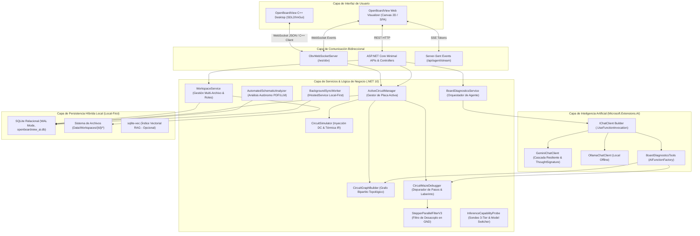

# 🏛️ Arquitectura del Sistema OpenBoardView AI (v4 Persistencia & Workspaces)

Este documento detalla la arquitectura completa de software de **OpenBoardView AI (Edición v4)**, desarrollada sobre **.NET 10 (`net10.0`)**, **`Microsoft.Extensions.AI`** y el motor gráfico C++ de **OpenBoardView**.

---

## 1. Visión General y Topología del Sistema

OpenBoardView AI opera mediante una **arquitectura híbrida desacoplada**:
1. **Core Nativo C++ (Desktop):** Visualizador acelerado por hardware con SDL2 e ImGui, soporte para decodificación de formatos de placa (`.brd`, `.bdv`, `.cad`, `.fz`), desencriptación bit-shift de placas Apple y puente cliente WebSocket en tiempo real.
2. **Backend de Inteligencia & Simulación .NET 10 (Servidor Local Kestrel):** Motor de cálculo topológico de grafos, simulación de leyes de Ohm y efecto Joule, indexador semántico de esquemáticos PDF (`PdfPig`), agente de razonamiento LLM con llamada a herramientas (*Function Calling*), persistencia relacional SQLite en modo WAL y servidor WebSocket bidireccional.
3. **Frontend Interactivo Web & Canvas (SPA Vanilla JS/HTML5):** Visor bidireccional con renderizado de vectores 2D, controles de inyección DC, cámara térmica FLIR simulada, depurador interactivo paso a paso (*Circuit Step Debugger*) con filtro de capacitores en paralelo, selector dinámico de espacios de trabajo y chip interactivo de estado de IA con conmutador de modelos.



---

## 2. Capa de Persistencia Relacional y Espacios de Trabajo (v4)

El sistema implementa una filosofía **Local-First**, permitiendo al técnico trabajar al 100% de manera autónoma en el banco de trabajo sin conexión obligatoria a internet.

### 2.1. Motor SQLite en Modo WAL
La persistencia se implementa en [`SqlitePersistenceService.cs`](file:///Users/marqzosvaldo/Documents/GitHub/OpenBoardView/src/OpenBoardView.AI/Persistence/SqlitePersistenceService.cs):
* **`PRAGMA journal_mode = WAL;`**: Escritura concurrente sin bloquear lecturas instantáneas.
* **`PRAGMA synchronous = NORMAL;`**: Rendimiento óptimo en discos de estado sólido asegurando integridad ante fallos.
* **`PRAGMA foreign_keys = ON;`**: Integridad referencial con eliminación en cascada (`ON DELETE CASCADE`) aplicada en cada conexión abierta.
* **`PRAGMA busy_timeout = 5000;`**: Manejo de bloqueo concurrente con hasta 5 segundos de espera activa.

### 2.2. Esquema Relacional de Base de Datos
La base de datos SQLite (`Data/openboardview_ai.db`) se inicializa automáticamente con el siguiente DDL:

```sql
-- 1. Espacios de Trabajo (Contenedores de Proyecto)
CREATE TABLE IF NOT EXISTS Workspaces (
    WorkspaceId TEXT PRIMARY KEY,
    Name TEXT NOT NULL,
    Description TEXT,
    SyncStatus INTEGER DEFAULT 0,
    AnalysisStatus TEXT DEFAULT 'NotRequested',
    ActivePresetId TEXT,
    AnalysisSummary TEXT,
    UpdatedAt TEXT NOT NULL DEFAULT (datetime('now')),
    CreatedAt TEXT NOT NULL DEFAULT (datetime('now'))
);

-- 2. Archivos Multi-Rol Asociados
CREATE TABLE IF NOT EXISTS WorkspaceFiles (
    FileId TEXT PRIMARY KEY,
    WorkspaceId TEXT NOT NULL,
    FileName TEXT NOT NULL,
    FilePath TEXT NOT NULL,
    FileType TEXT CHECK(FileType IN ('PHYSICAL_CAD', 'SCHEMATIC_PRIMARY', 'SCHEMATIC_ALT', 'AUX_DOC')),
    FileHash TEXT NOT NULL,
    FileSizeByte INTEGER NOT NULL,
    SyncStatus INTEGER DEFAULT 0,
    UpdatedAt TEXT NOT NULL DEFAULT (datetime('now')),
    FOREIGN KEY (WorkspaceId) REFERENCES Workspaces(WorkspaceId) ON DELETE CASCADE
);

-- 3. Caché de Placas y Hash SHA-256 (Arranque Instantáneo < 0.1s)
CREATE TABLE IF NOT EXISTS Boards (
    BoardId TEXT PRIMARY KEY,
    WorkspaceId TEXT NOT NULL,
    ModelName TEXT NOT NULL,
    BrdHash TEXT NOT NULL,
    PdfHash TEXT NOT NULL,
    CachedIndexJson TEXT,
    SyncStatus INTEGER DEFAULT 0,
    UpdatedAt TEXT NOT NULL DEFAULT (datetime('now')),
    FOREIGN KEY (WorkspaceId) REFERENCES Workspaces(WorkspaceId) ON DELETE CASCADE
);

-- 4. Componentes Indexados con Páginas Esquemáticas
CREATE TABLE IF NOT EXISTS Components (
    ComponentId TEXT NOT NULL,
    BoardId TEXT NOT NULL,
    Side TEXT CHECK(Side IN ('TOP', 'BOTTOM', 'BOTH')),
    Quadrant TEXT,
    PdfPage INTEGER,
    PinCount INTEGER,
    SyncStatus INTEGER DEFAULT 0,
    UpdatedAt TEXT NOT NULL DEFAULT (datetime('now')),
    PRIMARY KEY (BoardId, ComponentId),
    FOREIGN KEY (BoardId) REFERENCES Boards(BoardId) ON DELETE CASCADE
);

-- 5. Historial Estadístico de Reparaciones Resueltas
CREATE TABLE IF NOT EXISTS RepairHistory (
    RepairId TEXT PRIMARY KEY,
    WorkspaceId TEXT NOT NULL,
    BoardId TEXT NOT NULL,
    SymptomKey TEXT NOT NULL,
    FaultyComponent TEXT NOT NULL,
    FaultType TEXT CHECK(FaultType IN ('SHORT_TO_GND', 'OPEN_CIRCUIT', 'NO_ENABLE', 'IC_FAILURE', 'PCH_DAMAGE')),
    MeasuredImpedance REAL,
    MeasuredVoltage REAL,
    ResolvedAt TEXT NOT NULL DEFAULT (datetime('now')),
    Notes TEXT,
    SyncStatus INTEGER DEFAULT 0,
    UpdatedAt TEXT NOT NULL DEFAULT (datetime('now')),
    FOREIGN KEY (WorkspaceId) REFERENCES Workspaces(WorkspaceId) ON DELETE CASCADE,
    FOREIGN KEY (BoardId) REFERENCES Boards(BoardId) ON DELETE CASCADE
);

-- 6. Sesiones de Diagnóstico Pausables
CREATE TABLE IF NOT EXISTS DiagnosticSessions (
    SessionId TEXT PRIMARY KEY,
    WorkspaceId TEXT NOT NULL,
    BoardId TEXT NOT NULL,
    TechnicianName TEXT,
    CurrentStepIndex INTEGER DEFAULT 0,
    Status TEXT CHECK(Status IN ('IN_PROGRESS', 'RESOLVED', 'ABANDONED')),
    StepMeasurementsJson TEXT,
    SyncStatus INTEGER DEFAULT 0,
    UpdatedAt TEXT NOT NULL DEFAULT (datetime('now')),
    FOREIGN KEY (WorkspaceId) REFERENCES Workspaces(WorkspaceId) ON DELETE CASCADE,
    FOREIGN KEY (BoardId) REFERENCES Boards(BoardId) ON DELETE CASCADE
);

-- 7. Plantillas Curadas y Auto-Generadas de Diagnóstico
CREATE TABLE IF NOT EXISTS DiagnosticPresets (
    PresetId TEXT PRIMARY KEY,
    BoardId TEXT NOT NULL,
    SymptomKey TEXT NOT NULL,
    SymptomDescription TEXT,
    ColdShortThresholdReal REAL,
    ColdNormalMinReal REAL,
    PresetJson TEXT NOT NULL,
    SyncStatus INTEGER DEFAULT 0,
    UpdatedAt TEXT NOT NULL DEFAULT (datetime('now'))
);
```

### 2.3. Clasificación de Archivos (`FileRoleClassifier.cs`)
Al arrastrar o subir archivos al sistema, [`FileRoleClassifier`](file:///Users/marqzosvaldo/Documents/GitHub/OpenBoardView/src/OpenBoardView.AI/Services/FileRoleClassifier.cs) asigna automáticamente el rol según la extensión y patrones semánticos:
* **`PHYSICAL_CAD`**: Archivos `.brd`, `.bdv`, `.cad`, `.fz`, `.pcb`.
* **`SCHEMATIC_PRIMARY`**: Archivos `.pdf` cuyo nombre contiene `schematic`, `esquematico`, `diagram` o por descarte como plano principal.
* **`SCHEMATIC_ALT`**: Archivos `.pdf` que contienen identificadores de revisión previa o alterna (`rev`, `old`, `prelim`, `apr`).
* **`AUX_DOC`**: Archivos `.pdf`, `.txt`, imágenes o documentos con palabras clave como `manual`, `layout`, `boardview`, `dimension`, `cota`.

---

## 3. Caché de Inicio Instantáneo (< 0.10s) vs Parseo en Frío

En arquitecturas tradicionales, el parseo de un PDF esquemático complejo (como el de una MacBook Pro de 150+ páginas) mediante `PdfPig` requiere entre **30 y 60 segundos** en cada inicio.

### Mecanismo de Aceleración v4:
1. Al cargar una placa, [`ActiveCircuitManager`](file:///Users/marqzosvaldo/Documents/GitHub/OpenBoardView/src/OpenBoardView.AI/Services/ActiveCircuitManager.cs) calcula el hash SHA-256 en streaming tanto del archivo CAD como del PDF.
2. Consulta la tabla `Boards` en SQLite buscando la coincidencia exacta de ambos hashes.
3. **Acierto en Caché (`Cache HIT`):**
   * Lee directamente los miles de componentes, pines y asignaciones de páginas en **~40 a 80 milisegundos**.
   * El técnico tiene la interfaz lista instantáneamente.
4. **Fallo en Caché (`Cache MISS`):**
   * Se ejecuta el parseo completo una sola vez mediante [`BoardViewParser`](file:///Users/marqzosvaldo/Documents/GitHub/OpenBoardView/src/OpenBoardView.AI/Parsers/BoardViewParser.cs) y [`SchematicPdfReader`](file:///Users/marqzosvaldo/Documents/GitHub/OpenBoardView/src/OpenBoardView.AI/Parsers/SchematicPdfReader.cs).
   * La topología y el índice comprimido se almacenan en SQLite dentro de una transacción por lotes, quedando pre-indexados para todos los arranques futuros.

---

## 4. Administrador Dinámico de Circuitos (`ActiveCircuitManager.cs`)

En versiones previas, la placa activa requería reiniciar el servidor web para cambiar de archivo. En la v4:
* `ActiveCircuitManager` administra una instancia protegida por cerrojos (`_syncLock`) de:
  * `CircuitGraphBuilder` (Grafo de conexiones)
  * `CircuitSimulator` (Simulador de inyección de tensión y leyes de Kirchhoff/Ohm)
  * `CircuitMazeDebugger` (Depurador secuencial de pasos)
  * `FlowKnowledgeBase` (Base de conocimiento de la placa)
* La API `POST /api/workspaces/active/{id}` conmuta el circuito en memoria en tiempo de ejecución.
* Inmediatamente, emite un evento WebSocket a la interfaz web y al cliente C++ de OpenBoardView para recargar el canvas, las redes y los cuadrantes sin desconexión.

---

## 5. Servicio de Sincronización en Segundo Plano (`BackgroundSyncWorker.cs`)

Implementado como un `IHostedService` en .NET 10:
* Se ejecuta periódicamente (cada 5 minutos por defecto, configurable en `appsettings.json`).
* Detecta registros con `SyncStatus = 0` (local pendiente) en `RepairHistory`, `Workspaces` o `DiagnosticPresets`.
* Transmite deltas hacia el endpoint central de telemetría si existe conectividad.
* Si el taller está offline, el worker no arroja excepciones ni interrumpe la aplicación: registra un log de depuración y reintenta en el siguiente ciclo.
* Actualiza los registros transferidos a `SyncStatus = 1`.

---

## 6. Algoritmo de Filtrado de Desacoplo en Paralelo (`StepperParallelFilterV3.cs`)

En rieles de potencia maestros (como `PPBUS_G3H` o `PPDCIN_USBC_AON`), existen habitualmente de 20 a 60 capacitores cerámicos idénticos (0.1µF / 10µF) en paralelo conectados entre la línea y GND.
* **Problema:** En el depurador paso a paso, esto generaba 60 pasos repetitivos idénticos ("Medir C7100, Medir C7101, Medir C7102...").
* **Solución v3:**
  * El algoritmo analiza la topología mediante `IBrdTopologyProvider`.
  * Detecta si el componente es un capacitor (`Regex: ^(C|CE|C_)\d+`) y si uno de sus pines va a tierra.
  * **Modo Resumido (Filtro ON):** Agrupa todos los capacitores en paralelo de la misma red en **un solo nodo representativo** y añade la nota `(+N capacitores en paralelo omitidos)`.
  * **Modo Expandido (Filtro OFF):** Despliega el 100% de los capacitores individuales para análisis exhaustivo.
  * El técnico alterna entre ambos modos instantáneamente desde el switch reactivo en la barra del depurador.

---

## 7. Puente WebSocket Bidireccional (`ObvWebSocketServer.cs`)

El servidor WebSocket escucha en `/ws/obv` (puerto `5080`):
* **Comandos entrantes y salientes en formato JSON:**
  ```json
  {
    "action": "highlight" | "maze_debugger" | "simulate_flow" | "circuit_switch",
    "component": "F5601",
    "net": "PPDCIN_USBC_AON",
    "quadrant": "Q1",
    "x": 396,
    "y": 11032,
    "message": "Paso 1 del Diagnóstico USB-C: Medir F5601 (20V)",
    "simulation": { ... },
    "mazeTrace": { ... }
  }
  ```
* Coordina simultáneamente:
  1. El centrado y zoom de cámara en el cliente de escritorio C++ de OpenBoardView.
  2. La iluminación de pines y pistas en el Canvas 2D Web.
  3. El avance sincronizado del Stepper en la barra lateral.
