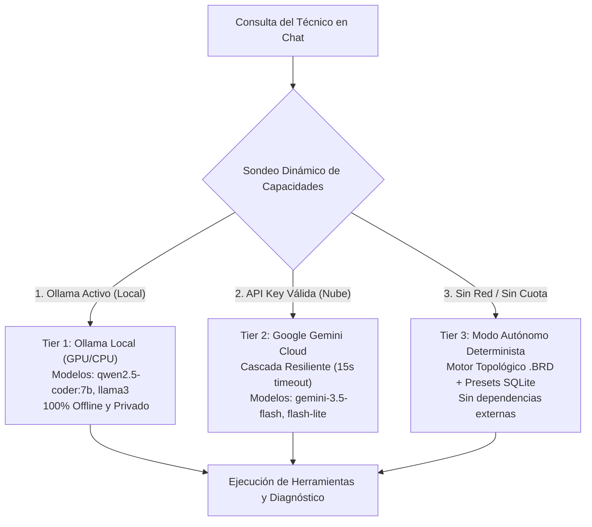
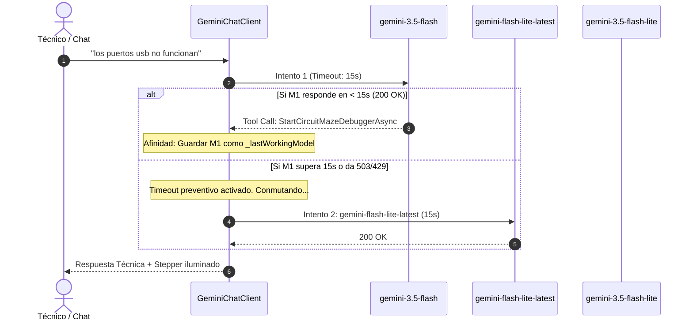

# 🧠 Guía de Proveedores de IA, Resiliencia y Cascada Multi-Modelo

Este documento describe la arquitectura de inferencia del agente de diagnóstico de **OpenBoardView AI**, desarrollada con **`Microsoft.Extensions.AI`** en **.NET 10**. Explica el sistema de resiliencia en tres niveles (Tier 1 a Tier 3), la cascada multi-modelo, los protocolos de llamada a funciones (*Function Calling*) y la integración interactiva en la interfaz de chat.

---

## 1. Arquitectura de Inferencia en 3 Niveles (3-Tier Fallback)

El sistema opera bajo un esquema adaptativo gestionado por [`InferenceCapabilityProbe.cs`](file:///Users/marqzosvaldo/Documents/GitHub/OpenBoardView/src/OpenBoardView.AI/Agent/InferenceCapabilityProbe.cs):



| Nivel (Tier) | Proveedor | Latencia | Requisitos | Casos de Uso |
| :--- | :--- | :--- | :--- | :--- |
| **Tier 1** | **Ollama Local** | ~1 a 4s (GPU) / ~8s (CPU) | Proceso Ollama corriendo en `http://localhost:11434` | Talleres de reparación sin internet, secreto industrial o análisis de placas propietarias. |
| **Tier 2** | **Google Gemini** | **~0.5s a 2.5s** | API Key gratuita de [Google AI Studio](https://aistudio.google.com/app/apikey) | Máxima velocidad, razonamiento avanzado de esquemáticos complejos y enriquecimiento multilingüe. |
| **Tier 3** | **Motor Determinista** | **< 10ms** | Ninguno (código C# puro en memoria) | Caídas de red, cuota de API temporalmente agotada o fallos de DNS. |

---

## 2. Cascada Resiliente de Modelos Gemini (`GeminiChatClient.cs`)

En producción con LLMs en la nube, los modelos pueden experimentar degradación de servicio (HTTP 503), saturación temporal o picos extremos de latencia. Por ejemplo, `gemini-flash-latest` (que mapea internamente a `gemini-3.8-flash`) en ocasiones presenta esperas de más de 100 segundos.

Para evitar que el técnico experimente bloqueos, [`GeminiChatClient.cs`](file:///Users/marqzosvaldo/Documents/GitHub/OpenBoardView/src/OpenBoardView.AI/Agent/GeminiChatClient.cs) implementa una **cascada automática con timeout preventivo de 15 segundos**:



### 2.1. Orden de Cascada Optimizado
1. **`gemini-3.5-flash`** *(Recomendado)*: Latencia típica de 1.8s a 3.1s, soporte completo de *Function Calling* y razonamiento técnico en español.
2. **`gemini-flash-lite-latest`**: Latencia ultrarrápida (0.5s a 1.2s), ideal para respuestas concisas.
3. **`gemini-3.5-flash-lite`**: Modelo redundante ligero.
4. **`gemini-flash-latest` / `gemini-3.8-flash`**: Modelos de reserva si los anteriores no están disponibles.

### 2.2. Afinidad de Modelo (`_lastWorkingModel`)
En ejecuciones con herramientas (*Function Calling*), el ciclo requiere al menos dos turnos:
* **Turno 1:** El modelo solicita ejecutar una herramienta (ej. `StartCircuitMazeDebuggerAsync`).
* **Turno 2:** El servidor envía el resultado de la medición/circuito y el modelo redacta el diagnóstico final.

`GeminiChatClient` almacena en `_lastWorkingModel` el modelo que respondió con éxito en el Turno 1. Así, el Turno 2 se envía **directamente al mismo modelo sin reintentos ni retardos de conmutación**.

---

## 3. Protocolo Crítico de Function Calling en Gemini v1beta

La integración de llamadas a herramientas con Google Gemini en .NET 10 exige el cumplimiento estricto de cuatro reglas de bajo nivel:

### 3.1. Preservación Obligatoria de `thoughtSignature`
Los modelos recientes de la serie Gemini (incluyendo Gemini 3 / 3.5) generan un campo binario interno denominado `thoughtSignature` (o `thought_signature`) al emitir una llamada a función:
* **Regla:** Si una respuesta con `functionCall` contiene un `thoughtSignature`, este debe **preservarse y enviarse intacto** en la llamada subsiguiente.
* **Consecuencia de omitirlo:** La API de Google rechaza la petición con:  
  `HTTP 400 Bad Request: "Function call is missing a thought_signature in functionCall parts"`.
* **Solución en OpenBoardView AI:**
  ```csharp
  if (part.TryGetProperty("thoughtSignature", out var tsElem))
  {
      var ts = tsElem.GetString();
      callContent.AdditionalProperties["thoughtSignature"] = ts;
      _thoughtSignaturesByTool[name] = ts; // Almacenado para el Turno 2
  }
  ```

### 3.2. Nombre de Función en `functionResponse`
En el Turno 2, la especificación de Gemini requiere que el campo `functionResponse.name` contenga el **nombre real de la función declarada** (`StartCircuitMazeDebuggerAsync`, `SearchNets`), y **NO** el identificador abstracto de llamada (`call_1923726`).
```csharp
// Correcto (Gemini v1beta):
var funcResp = new JsonObject
{
    ["name"] = functionName, // ej: "StartCircuitMazeDebuggerAsync"
    ["response"] = responseStruct
};
```

### 3.3. Restricción de `thinkingConfig` en Modelos Flash-Lite
En la API v1beta de Gemini, enviar `"thinkingConfig": {"thinkingBudget": 0}` junto con herramientas (*tools*) en modelos ligeros (`gemini-flash-lite-latest`) provoca un error inmediato:
`HTTP 400: "Request contains an invalid argument"`.
* **Solución en OpenBoardView AI:** No inyectar `thinkingConfig` artificialmente; permitir que el runtime de Google determine la configuración de razonamiento compatible.

### 3.4. Sanitización de JSON Schemas
El serializador de esquemas de C# (`System.Text.Json`) a menudo incluye `$schema` y `additionalProperties: false`. Gemini v1beta no tolera `$schema` en los parámetros de herramientas. `GeminiChatClient.SanitizarSchemaParaGemini()` limpia recursivamente:
* `$schema`
* `additionalProperties`
* Nodos `default: null`

---

## 4. Chip Interactivo de Estado y Conmutador en el Chat (`index.html`)

En la esquina superior del panel de chat (`#chatHistory`) se encuentra el **Chip de Estado de IA**:

```
[ 🟢 | gemini-3.5-flash ▼ | Online | 🔄 ]
```

### 4.1. Componentes del Chip
1. **Indicador de Punto (`.ai-chip-dot`):**
   * 🟢 **Verde (`#22c55e`):** Conectividad verificada y cuota activa.
   * 🔴 **Rojo (`#ef4444`):** Sin conexión, modelo inaccesible o API Key no configurada.
   * 🟡 **Amarillo (`#f59e0b`):** Verificación o reintento en curso.
2. **Selector de Modelos (`#aiModelSelect`):**
   * Menú desplegable interactivo que permite al técnico alternar en vivo entre:
     - `gemini-3.5-flash` *(Recomendado)*
     - `gemini-flash-lite-latest`
     - `gemini-3.5-flash-lite`
     - `gemini-flash-latest`
     - `gemini-3.8-flash`
   * Al seleccionar un modelo, el sistema realiza un sondeo inmediato y ajusta la preferencia sin reiniciar el servidor.
3. **Botón de Reintento (`#btnAiRetry`):**
   * Dispara una llamada a `POST /api/agent/capabilities/retry`.
   * Muestra una animación giratoria (`fa-spin`) durante el chequeo.
4. **Popover de Configuración Rápida de API Key (`#apiKeyPopover`):**
   * Al hacer clic sobre el chip en estado Offline, se despliega una ventana flotante para pegar o actualizar el API Key de Gemini en caliente.
   * La clave se almacena en memoria en el servidor y revalida la conexión al instante.

---

## 5. Endpoints REST de la Capa de Inferencia

| Método | Endpoint | Descripción |
| :--- | :--- | :--- |
| `GET` | `/api/agent/capabilities` | Consulta el estado actual del proveedor activo, badge de color y lista de modelos detectados. |
| `POST` | `/api/agent/capabilities/retry` | Fuerza un sondeo en caliente descartando la caché de conectividad previa. |
| `POST` | `/api/agent/capabilities/model` | Cambia el modelo activo al especificado en el cuerpo (`{"model": "gemini-3.5-flash"}`). |
| `POST` | `/api/agent/capabilities/apikey` | Actualiza la API Key en memoria (`{"apiKey": "AIzaSy..."}`) y re-sondea capacidades. |
| `POST` | `/api/agent/intent` | Analizador semántico NLP: extrae la red principal, componentes involucrados y modo diagnóstico. |
| `POST` | `/api/agent/query` | Ejecución síncrona completa del agente con llamada a herramientas y comandos WebSocket. |
| `POST` | `/api/agent/stream` | Transmisión en tiempo real mediante Server-Sent Events (SSE) para renderizado de texto fluido. |
