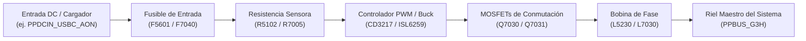
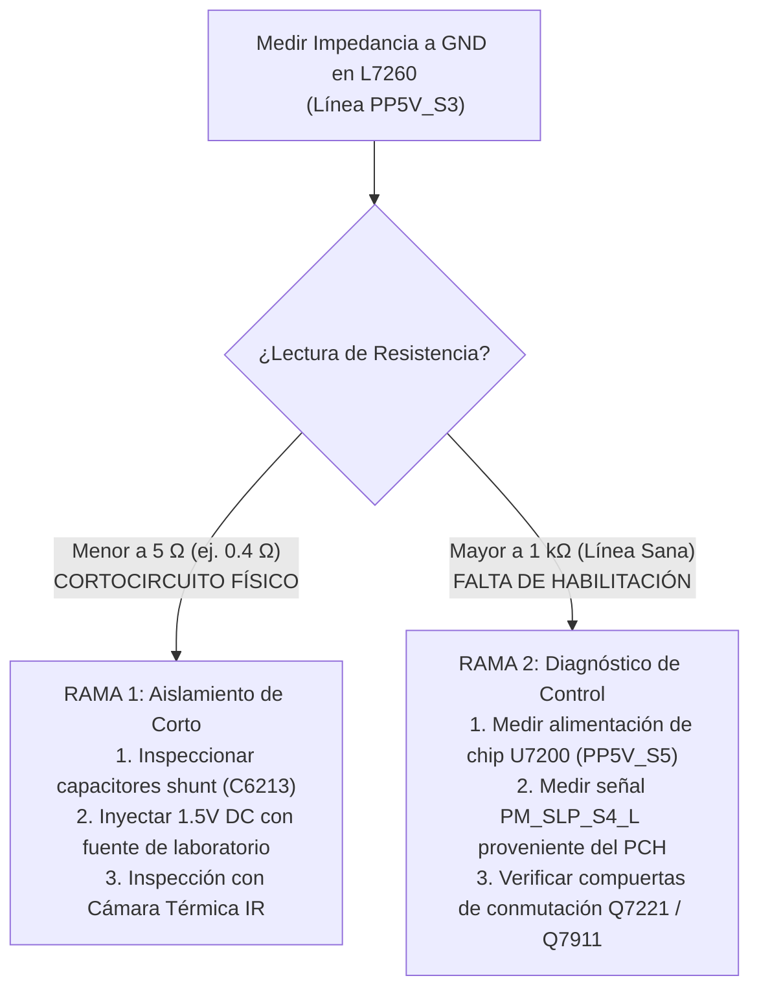
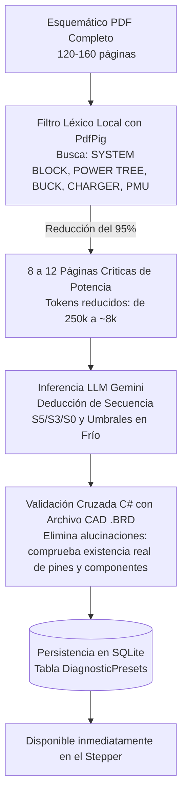

# 🧭 Sistema Predictivo, Circuit Step Debugger y Optimización Topológica

Este documento detalla el funcionamiento interno del **Circuit Step Debugger (Modo Laberinto)**, el motor de **Inteligencia Predictiva basada en Historial de Reparaciones**, el **Filtro de Desacoplo en Paralelo (v3)** y el **Analizador Autónomo de Esquemáticos (v4)** integrados en **OpenBoardView AI**.

---

## 1. El Depurador Secuencial de Pasos (Circuit Step Debugger)

El diagnóstico en microelectrónica no consiste en medir componentes al azar, sino en seguir la **ruta de señal y potencia en orden topológico estricto**, verificando las condiciones necesarias en cada nodo antes de pasar al siguiente.

### 1.1. Modos de Medición en el Stepper
Cada paso del depurador especifica con precisión:
1. **Medición de Tensión DC (`measurementMode: "voltage"`):**
   * Punta negra del multímetro en chasis (tierra/GND) y punta roja en el pin indicado.
   * Se compara con el valor esperado (ej. `20.00 V`, `12.56 V`, `3.42 V`).
2. **Medición de Resistencia / Impedancia en Frío (`measurementMode: "resistance"`):**
   * Placa totalmente desenergizada (sin batería ni cargador).
   * Multímetro en escala de resistencia ($\Omega$) o modo diodo.
   * Utilizado para bifurcar árboles de decisión lógicos antes de energizar la placa.

---

## 2. Árboles de Decisión y Bifurcaciones Lógicas

En rieles secundarios (como `PP5V_S3` o `PPVCORE_S0_CPU`), la ausencia de voltaje puede deberse a dos causas radicalmente distintas:
1. **Causa Física:** Un capacitor cerámico o diodo está en cortocircuito directo a tierra.
2. **Causa Lógica:** La línea está en perfecto estado, pero el circuito integrado no recibe la señal de habilitación (*ENABLE*) o alimentación auxiliar.

### Ejemplo: Árbol de Decisión en `PP5V_S3` (Bobina `L7260`)

Si el técnico mide un cortocircuito en el paso de bifurcación, el sistema reconfigura dinámicamente los siguientes pasos hacia el aislamiento del componente en corto; si la impedancia es normal, el sistema lo dirige hacia las señales de control del PCH.

---

## 3. Memoria Estadística e Inteligencia Predictiva (v4)

A diferencia de las guías estáticas, OpenBoardView AI aprende acumulativamente de cada reparación resuelta en el taller mediante la tabla `RepairHistory` de SQLite.

### 3.1. Cálculo de Probabilidad Histórica de Falla
Para una placa $B$ y un síntoma $S$, la probabilidad estadística de que el componente $C_i$ sea el culpable se calcula en tiempo real mediante:

$$P(C_i \mid S, B) = \frac{\text{ConteoFallos}(C_i, S, B)}{\sum_{k=1}^{N} \text{ConteoFallos}(C_k, S, B)} \times 100$$

### 3.2. Priorización Dinámica del Stepper
Cuando el técnico inicia el depurador para un síntoma determinado:
1. `SqlitePersistenceService.GetTopFailingComponentsAsync(boardId, symptomKey)` consulta el historial histórico.
2. Si un componente presenta una alta incidencia histórica (por ejemplo, `C7513` con 82% de fallos en `PPBUS_G3H` ausente):
   * Se inserta un **Atajo Predictivo (*Shortcut Chip*)** en la parte superior del Stepper:
     `[ ⚡ Atajo: Medir C7513 (82% de probabilidad histórica) ]`
   * Si el técnico decide medirlo primero y confirma el fallo, se ahorra recorrer 8 pasos intermedios, reduciendo el tiempo de diagnóstico de 20 minutos a menos de 60 segundos.

### 3.3. Registro de Reparaciones Resueltas
Al presionar el botón **`Marcar como Caso Resuelto`** en la interfaz:
* Se abre un diálogo modal solicitando:
  * Síntoma confirmado (`SymptomKey`).
  * Componente defectuoso (`FaultyComponent`, ej. `C7513`).
  * Tipo de avería: `SHORT_TO_GND`, `OPEN_CIRCUIT`, `NO_ENABLE`, `IC_FAILURE`, `PCH_DAMAGE`.
  * Mediciones tomadas (ohmios y voltios).
  * Notas técnicas.
* La reparación se persiste de inmediato con `SyncStatus = 0` (local) para retroalimentar el modelo estadístico.

---

## 4. Filtro de Desacoplo en Paralelo (`StepperParallelFilterV3`)

### 4.1. El Problema de la Saturación de Pasos
En rieles de potencia principales como `PPBUS_G3H` o `PPDCIN_USBC_AON`, los fabricantes colocan decenas de capacitores cerámicos multicapa (MLCC) idénticos en paralelo entre la pista y tierra para filtrar el rizado (*ripple*):
* En una placa Apple MacBook A2918 (M3), existen más de **45 capacitores en paralelo** conectados a `PPDCIN_USBC_AON`.
* Un recorrido topológico ingenuo genera 45 pasos sucesivos prácticamente idénticos, abrumando al técnico y restando claridad al diagnóstico.

### 4.2. El Algoritmo de Filtrado Reactivo
El motor [`StepperParallelFilterV3.cs`](file:///Users/marqzosvaldo/Documents/GitHub/OpenBoardView/src/OpenBoardView.AI/Algorithms/StepperParallelFilterV3.cs) procesa la secuencia con dos modos:

1. **Modo Resumido / Limpio (`isFilterEnabled = true`, Predeterminado):**
   * Inspecciona cada nodo mediante `IBrdTopologyProvider.IsComponentPinConnectedToGnd(componentId)`.
   * Si el componente es un capacitor (`Regex: ^(C|CE|C_)\d+`) y está en paralelo a tierra, colapsa los capacitores sucesivos de la misma red en **un único paso representativo**.
   * Agrega el contador y la lista de componentes consolidados:
     `"Filtro de Desacoplo (C5600) [+44 capacitores en paralelo omitidos]"`.
   * **Salvaguarda de Componentes Críticos:** Fusibles, bobinas, resistencias en serie y chips nunca son filtrados.
2. **Modo Expandido (`isFilterEnabled = false`):**
   * Despliega la totalidad de los componentes individuales sin omisión.
3. **Switch Reactivo en UI:**
   * Ubicado en la cabecera del Stepper:
     `[ Filtro Paralelo: ON / OFF ]`
   * Permite alternar en tiempo real entre ambas representaciones sin perder el progreso del diagnóstico ni reiniciar el paso actual.

---

## 5. Sesiones Diagnósticas Pausables (`DiagnosticSessions`)

Las reparaciones de microelectrónica en talleres reales con frecuencia deben suspenderse:
* Para esperar la llegada de un componente de repuesto.
* Por cambio de turno del técnico o finalización de la jornada laboral.

### Mecanismo de Pausa y Reanudación:
1. El servidor persiste continuamente el estado en la tabla `DiagnosticSessions`:
   * `CurrentStepIndex`: Paso en el que se encuentra el técnico.
   * `StepMeasurementsJson`: Arreglo de lecturas confirmadas (ej. `[{"step": 1, "component": "F5601", "voltage": 20.0, "status": "PASSED"}]`).
   * `Status`: `IN_PROGRESS`, `RESOLVED`, `ABANDONED`.
2. Al abrir el Workspace al día siguiente, el sistema detecta la sesión activa y muestra una notificación:
   `"Sesión diagnóstica previa detectada en Paso 3 (FF201). ¿Deseas reanudarla?"`
3. Al confirmar, el visor restaura las mediciones previas, ilumina el componente correspondiente y posiciona el cursor exactamente donde quedó.

---

## 6. Motor Autónomo de Análisis de Esquemáticos (`AutomatedSchematicAnalyzer.cs`)

Para placas nuevas que no cuentan con plantillas curadas en la base de conocimiento, el sistema incluye un motor de análisis autónomo capaz de ingerir esquemáticos en PDF de más de 150 páginas.

### Ventajas Técnicas:
* **Ahorro Masivo de Tokens:** Pasa de consumir ~250,000 tokens a solo ~8,000 tokens por análisis, permitiendo operar dentro de cuotas gratuitas de IA sin exceder límites de contexto.
* **Eliminación Total de Alucinaciones:** Ningún componente sugerido por el LLM se presenta al usuario a menos que su identificador y redes existan físicamente en el archivo CAD `.brd` verificado por código C#.
* **Disponibilidad Permanente:** Una vez analizada la placa, la plantilla se guarda en SQLite y disco (`Presets/*_autogenerated.json`), de modo que no requiere volver a consultar la IA en el futuro.
