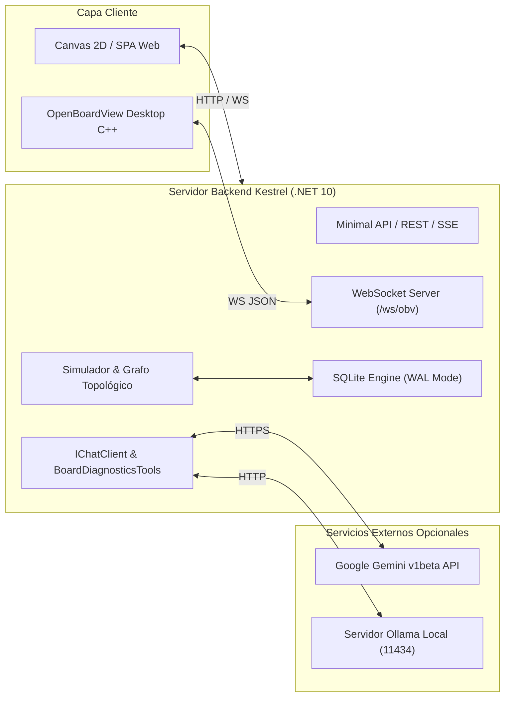
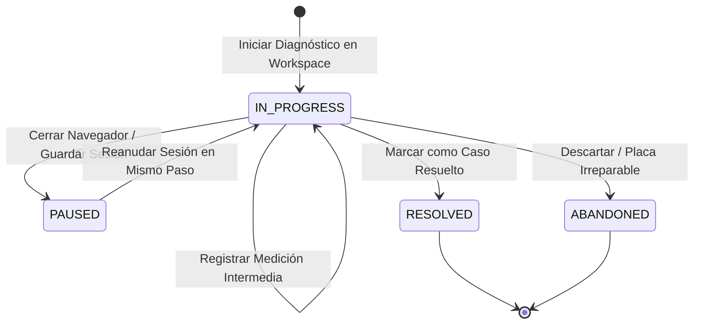
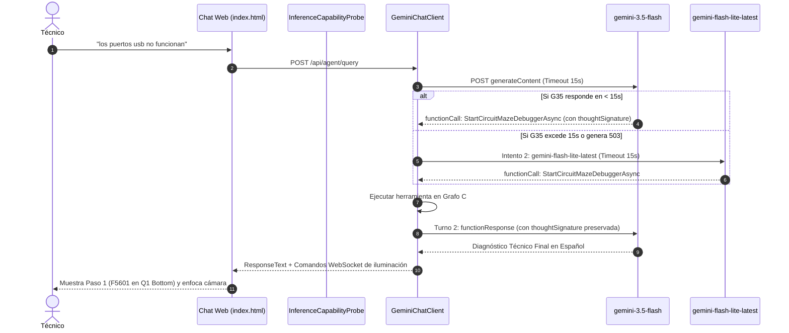

# 📋 SOFTWARE REQUIREMENTS SPECIFICATION (SRS)
## OpenBoardView AI & Circuit Simulator Edition (v4.2.0)
**Estándar:** IEEE Std 830-1998 / ISO/IEC/IEEE 29148:2018  
**Fecha y Hora de Emisión:** 2026-10-25 22:18:18 (Hora Local)  
**Estado:** Formal / Aprobado  
**Clasificación:** Ingeniería de Software y Especificación de Requerimientos de Sistema  

---

## Control del Documento

| Versión | Fecha | Autor / Equipo | Descripción de Cambios |
| :--- | :--- | :--- | :--- |
| **1.0.0** | 2026-08-10 | Equipo Core OpenBoardView | Especificación inicial del motor C++ y visor SDL2/ImGui. |
| **2.0.0** | 2026-09-15 | Equipo OpenBoardView AI | Adición de backend .NET 10, simulación DC y asistente LLM básico. |
| **3.0.0** | 2026-10-12 | Equipo OpenBoardView AI | Incorporación de árboles de decisión en frío, filtro de desacoplo v3 y base de conocimiento curada. |
| **4.2.0** | **2026-10-25** | **Equipo OpenBoardView AI** | **Persistencia relacional SQLite WAL, Workspaces multi-archivo, caché <0.1s, cascada resiliente Gemini con timeout de 15s, preservación de thoughtSignature, memoria predictiva y analizador autónomo de esquemáticos.** |

---

## 1. Introducción

### 1.1. Propósito
El presente documento de Especificación de Requerimientos de Software (SRS) define de forma exhaustiva, verificable y formal los requerimientos funcionales, no funcionales, interfaces externas y restricciones de diseño para **OpenBoardView AI & Circuit Simulator Edition (v4.2.0)**. Sirve como contrato técnico para ingenieros de desarrollo, especialistas en aseguramiento de calidad (QA), auditores técnicos y modelos de lenguaje para ingestión contextual.

### 1.2. Convenciones del Documento
* Los requerimientos funcionales se identifican con la nomenclatura **`FR-[NN]`**.
* Los requerimientos no funcionales se identifican con la nomenclatura **`NFR-[NN]`**.
* Los niveles de prioridad se rigen por la norma RFC 2119:
  * **DEBE (SHALL / MUST):** Requisito mandatorio e irrenunciable para la operación del sistema.
  * **DEBERÍA (SHOULD):** Requisito altamente deseable con justificación formal en caso de diferimiento.
  * **PODRÍA (MAY):** Característica opcional o configurable.

### 1.3. Audiencia Prevista
* **Desarrolladores de Software:** Para implementación y mantenimiento de los componentes C#, C++, JavaScript y esquemas SQL.
* **Técnicos e Ingenieros de Microelectrónica:** Para validación operativa de flujos diagnósticos, inyección de tensión y leyes de circuitos.
* **Agentes de IA y Sistemas RAG:** Para generación de código, resolución de consultas y trazabilidad de requerimientos.

### 1.4. Alcance del Producto
OpenBoardView AI es una solución híbrida orientada al diagnóstico, prueba y reparación de placas de circuitos impresos (PCB). El sistema procesa archivos físicos CAD (`.brd`, `.bdv`, `.cad`, `.fz`), esquemáticos electrónicos (`.pdf`), simula variables físicas (tensión, corriente, calentamiento Joule) y orquesta un agente de inteligencia artificial multimodal capaz de navegar el circuito y coordinar la interfaz de usuario en tiempo real.

### 1.5. Referencias Normativas
1. *IEEE Std 830-1998: IEEE Recommended Practice for Software Requirements Specifications.*
2. *ISO/IEC/IEEE 29148:2018: Systems and software engineering — Life cycle processes — Requirements engineering.*
3. *Microsoft.Extensions.AI: Standard Abstractions for AI Services in .NET 10.*
4. *SQLite Database Engine: Write-Ahead Logging (WAL) Technical Specification.*
5. *Google Generative Language API v1beta: Function Calling & Tool Definition Specification.*

---

## 2. Descripción General del Sistema

### 2.1. Perspectiva del Producto
El sistema opera como una plataforma desacoplada local (*Local-First*):

### 2.2. Clases de Usuario y Características
1. **Técnico de Laboratorio / Reparador:** Usuario principal. Utiliza multímetro, estación de soldadura y fuente de banco; requiere guías paso a paso, valores esperados de tensión/resistencia y ubicación visual inmediata en la placa.
2. **Ingeniero de Hardware / Reverse Engineer:** Analiza esquemáticos no documentados, genera presets diagnósticos y valida líneas de potencia complejas.
3. **Desarrollador / Integrador:** Automatiza pruebas, extiende el catálogo de herramientas de IA o integra dispositivos externos mediante WebSockets.

### 2.3. Entorno Operativo
* **Sistemas Operativos:** macOS (ARM64 / x64, macOS 12+), Linux (Ubuntu 20.04+, Debian, Fedora), Microsoft Windows (10 / 11 x64 / ARM64).
* **Entorno de Ejecución:** .NET 10 SDK (`net10.0`).
* **Navegadores Soportados:** Navegadores modernos con soporte para HTML5 Canvas, WebSockets y Server-Sent Events (Chrome 90+, Safari 15+, Firefox 90+, Edge 90+).
* **Puerto de Enlace Predeterminado:** TCP `5080` (HTTP / WebSocket).

### 2.4. Restricciones de Diseño e Implementación
1. **Operación Local-First:** El sistema DEBE funcionar al 100% de sus capacidades mecánicas, gráficas y de cálculo topológico sin conexión a internet.
2. **Cero Fuga de Credenciales:** Las API Keys jamás DEBEN almacenarse en archivos versionados por Git ni transmitirse a terceros ajenos al proveedor de inferencia seleccionado.
3. **Preservación de Tiempos de Respuesta:** El arranque con placas pre-indexadas DEBE ser inferior a 100 milisegundos.

---

## 3. Requerimientos de Interfaces Externas

### 3.1. Interfaces de Usuario (UI)
* **UI-01 (Canvas 2D Interactivo):** Renderizado de contorno, componentes con pines, etiquetas de redes, cuadrantes espaciales (`Q1` a `Q4`) y conmutador de cara (`TOP`, `BOTTOM`, `Ambas`).
* **UI-02 (Panel de Stepper / Laberinto):** Muestra el paso activo, número de nodo, componente, red de entrada/salida, lectura esperada, botones de avance (`Hay Voltaje`) y fallo (`0V Aquí`).
* **UI-03 (Switch Reactivo de Filtro Paralelo):** Control tipo toggle switch que alterna instantáneamente entre el modo resumido (agrupando capacitores de desacoplo a GND) y el modo expandido.
* **UI-04 (Chip de Estado de IA en Chat):**
  * Indicador de punto: 🟢 Verde (Online y funcional) / 🔴 Rojo (Offline o error) / 🟡 Amarillo (Sondeando).
  * Selector desplegable de modelos (`<select id="aiModelSelect">`).
  * Botón interactivo de reintento (`🔄`).
  * Popover flotante para actualización de API Key en caliente.
* **UI-05 (Modal de Workspaces):** Dropzone con soporte de arrastrar y soltar para carga multi-archivo con visualización de roles por colores.

### 3.2. Interfaces de Software
* **SW-01 (SQLite 3 WAL Engine):** Base de datos relacional local `openboardview_ai.db` con soporte concurrente de lectura/escritura.
* **SW-02 (Google Generative Language API v1beta):** Endpoint HTTPS para inferencia LLM con Function Calling.
* **SW-03 (Ollama Local Daemon):** Endpoint HTTP `http://localhost:11434` para inferencia local sin conexión.
* **SW-04 (UglyToad.PdfPig):** Librería C# para parseo léxico de esquemáticos en PDF.

### 3.3. Interfaces de Comunicación
* **COM-01 (Servidor WebSocket `/ws/obv`):** Protocolo JSON full-duplex para broadcast de comandos de cámara, selección e iluminación.
* **COM-02 (Server-Sent Events `/api/agent/stream`):** Transmisión unidireccional HTTP con tipo de contenido `text/event-stream` para streaming de respuestas del agente.

---

## 4. Requerimientos Funcionales del Sistema (FR)

### FR-01: Ingesta de Boardviews y Desencriptación Apple
* **Descripción:** El sistema DEBE ingerir archivos físicos en formatos `.brd`, `.bdv`, `.cad`, `.fz`.
* **Detalle:** Si el archivo contiene la cabecera propietaria de Apple (`0x23 0xE2 0x63 0x28`), el sistema DEBE aplicar el algoritmo de descifrado bit-shift en memoria antes de parsear partes, pines y contornos.

### FR-02: Particionado Espacial y Grafo Bipartito
* **Descripción:** El sistema DEBE estructurar la placa como un grafo bipartito no dirigido $G = (C, N, E)$ donde $C$ es el conjunto de componentes y $N$ el conjunto de redes (*nets*).
* **Detalle:** Cada componente DEBE asignarse automáticamente a uno de cuatro cuadrantes espaciales (`Q1` a `Q4`) calculados sobre el Bounding Box de la placa.

### FR-03: Persistencia de Espacios de Trabajo y Caché (< 0.10s)
* **Descripción:** El sistema DEBE agrupar los archivos asociados a una placa en contenedores lógicos denominados *Workspaces* identificados con UUID v4.
* **Detalle:** El sistema DEBE calcular el hash SHA-256 de los archivos CAD y PDF. Si la tupla existe en la tabla `Boards`, la topología DEBE cargarse desde la base de datos SQLite en un tiempo menor a 100 milisegundos sin re-ejecutar `PdfPig`.

### FR-04: Simulación de Fuente de Banco DC y Efecto Joule
* **Descripción:** El sistema DEBE simular la inyección de tensión DC (0.5V a 12.6V) y límite de corriente (0.5A a 5.0A) sobre cualquier red seleccionada.
* **Detalle:** El sistema DEBE calcular la disipación de calor ($P = I^2 \times R$), identificar candidatos en cortocircuito a tierra y superponer un mapa térmico simulado tipo FLIR.

### FR-05: Depurador Secuencial de Pasos y Árboles de Decisión
* **Descripción:** El sistema DEBE generar un sendero secuencial de diagnóstico (*Circuit Maze Trace*) para síntomas de encendido y carga.
* **Detalle:** El depurador DEBE soportar bifurcaciones lógicas mediante medición en frío de impedancia a tierra ($\Omega$): lecturas $< 5\,\Omega$ derivan a ramas de aislamiento de corto; lecturas $> 1\,\text{k}\Omega$ derivan a ramas de control de habilitación (*Enable*).

### FR-06: Filtro Topológico de Desacoplo en Paralelo (v3)
* **Descripción:** El sistema DEBE detectar capacitores cerámicos conectados en paralelo entre un riel de alimentación y GND mediante `IBrdTopologyProvider`.
* **Detalle:** Con el switch en posición activa (ON), el algoritmo DEBE colapsar los capacitores en paralelo redundantes en un único paso representativo indicando el conteo de elementos omitidos (`+N omitidos`), sin ocultar jamás fusibles, bobinas o resistencias en serie.

### FR-07: Memoria Predictiva de Reparación
* **Descripción:** El sistema DEBE persistir las reparaciones exitosas en la tabla `RepairHistory`.
* **Detalle:** El depurador DEBE calcular en tiempo real la probabilidad condicional de fallo para cada componente y síntoma, inyectando atajos de alta prioridad (*Shortcut Chips*) al inicio del Stepper si la probabilidad histórica supera el 30%.

### FR-08: Analizador Autónomo de Esquemáticos (v4)
* **Descripción:** El sistema DEBE permitir el análisis autónomo de esquemáticos PDF de más de 100 páginas.
* **Detalle:** El motor DEBE aplicar filtrado léxico local con `PdfPig` para extraer únicamente las 8 a 12 páginas de potencia (reduciendo tokens de 250k a ~8k). Todo componente propuesto por el LLM DEBE ser validado contra el archivo CAD físico; si no existe en el `.brd`, DEBE descartarse para eliminar alucinaciones.

### FR-09: Resiliencia Multi-Modelo y Cascada con Timeout de 15s
* **Descripción:** El adaptador `GeminiChatClient` DEBE implementar una cascada multi-modelo automática ante errores HTTP 503, 429 o demoras excesivas.
* **Detalle:** Cada intento individual de modelo DEBE estar acotado por un timeout de 15 segundos. Si se excede, el sistema DEBE conmutar de inmediato al siguiente modelo en el orden: `gemini-3.5-flash` $\longrightarrow$ `gemini-flash-lite-latest` $\longrightarrow$ `gemini-3.5-flash-lite`.

### FR-10: Integridad de Function Calling y ThoughtSignature
* **Descripción:** El adaptador de IA DEBE preservar y reenviar íntegramente el token `thoughtSignature` / `thought_signature` en el Turno 2 de ejecución de herramientas para satisfacer el protocolo de Gemini 3.
* **Detalle:** El campo `functionResponse.name` DEBE contener estrictamente el nombre real de la función declarada y no el identificador interno de llamada (`call_id`).

### FR-11: Sesiones Diagnósticas Pausables
* **Descripción:** El sistema DEBE persistir el avance de una reparación en la tabla `DiagnosticSessions`.
* **Detalle:** Si un técnico cierra la aplicación y la vuelve a abrir, el sistema DEBE detectar la sesión en progreso y permitir reanudar exactamente en el paso y mediciones previas.

### FR-12: Sincronización en Segundo Plano hacia la Nube
* **Descripción:** El servicio `BackgroundSyncWorker` DEBE ejecutarse en segundo plano como un `IHostedService` cada 5 minutos.
* **Detalle:** DEBE consultar registros con `SyncStatus = 0` y transmitirlos a la API de telemetría. Si no hay conexión a internet, DEBE capturar el error de red de forma transparente sin degradar la experiencia de usuario.

---

## 5. Requerimientos No Funcionales (NFR)

### 5.1. Rendimiento (Performance)
* **NFR-01 (Tiempo de Arranque con Caché):** La carga completa de una placa pre-indexada DEBE completarse en menos de **100 milisegundos**.
* **NFR-02 (Timeout de Inferencia):** Ningún modelo individual en la nube DEBE retener el hilo de ejecución por más de **15 segundos** antes de activar el failover.
* **NFR-03 (Fluidez de Renderizado):** El Canvas 2D Web DEBE mantener un mínimo de **50 cuadros por segundo (FPS)** durante operaciones de paneo, zoom y animación de partículas.
* **NFR-04 (Huella de Memoria):** El proceso Kestrel en .NET 10 NO DEBE superar los **450 MB de memoria RAM** en reposo con una placa de 5,000 componentes cargada.

### 5.2. Concurrencia e Integridad de Datos
* **NFR-05 (Aislamiento SQLite):** La base de datos DEBE operar en modo WAL (*Write-Ahead Logging*), asegurando que múltiples lecturas no bloqueen escrituras concurrentes.
* **NFR-06 (Integridad Referencial):** Toda conexión a la base de datos DEBE ejecutar `PRAGMA foreign_keys = ON;` para garantizar que la eliminación de un Workspace borre en cascada sus archivos y cachés asociadas.

### 5.3. Seguridad y Privacidad
* **NFR-07 (Cero Exposición de Secretos):** Archivos con claves locales (`appsettings.Local.json`, `.env`) DEBEN estar excluidos en `.gitignore`.
* **NFR-08 (Protección Path Traversal):** Toda subida de archivos DEBE sanitizar los nombres mediante `Path.GetFileName()` para mitigar vulnerabilidades de inyección de rutas (`../../`).

---

## 6. Matriz de Trazabilidad y Verificación

| Requerimiento | Componente de Implementación | Endpoint / Canal | Prueba Unitaria (xUnit) |
| :--- | :--- | :--- | :--- |
| **FR-01** (Desencriptación BRD) | `BoardViewParser.cs` | `/api/board/geometry` | `KnowledgeAndDebuggerTests` |
| **FR-02** (Grafo y Cuadrantes) | `CircuitGraphBuilder.cs` | `/api/board/overview` | `KnowledgeAndDebuggerTests` |
| **FR-03** (Workspaces & Caché <0.1s) | `WorkspaceService.cs`, `SqlitePersistenceService.cs` | `/api/workspaces`, `/api/workspaces/upload` | `PersistenceTests.Test_Workspace_Full_Lifecycle` |
| **FR-04** (Simulador DC & Térmico) | `CircuitSimulator.cs` | `/api/board/simulate`, `/ws/obv` | `KnowledgeAndDebuggerTests` |
| **FR-05** (Step Debugger & Árboles) | `CircuitMazeDebugger.cs` | `/api/board/debugger/trace` | `KnowledgeAndDebuggerTests.Test_PP5V_S3_Decision_Tree` |
| **FR-06** (Filtro Paralelo v3) | `StepperParallelFilterV3.cs` | `/api/board/debugger/trace` | `StepperParallelFilterTests.Test_Filter_Decoupling_Caps` |
| **FR-07** (Memoria Predictiva) | `SqlitePersistenceService.cs` | `/api/repairs`, `/api/repairs/stats` | `PersistenceTests.Test_RepairHistory_Probability_Calculation` |
| **FR-08** (Analizador Esquemáticos) | `AutomatedSchematicAnalyzer.cs` | `/api/workspaces/{id}/trigger-analysis` | `KnowledgeAndDebuggerTests` |
| **FR-09** (Cascada Gemini 15s) | `GeminiChatClient.cs` | `/api/agent/query`, `/api/agent/stream` | `KnowledgeAndDebuggerTests` |
| **FR-10** (ThoughtSignature) | `GeminiChatClient.cs` | `/api/agent/query` | `KnowledgeAndDebuggerTests` |
| **FR-11** (Sesiones Pausables) | `SqlitePersistenceService.cs` | `/api/sessions`, `/api/sessions/active` | `PersistenceTests.Test_DiagnosticSessions_PauseAndResume` |
| **FR-12** (Sincronización Cloud) | `BackgroundSyncWorker.cs` | Tarea en Segundo Plano (`IHostedService`) | `PersistenceTests` |

---

## 7. Anexos y Modelos de Estado

### Anexo A: Diagrama de Transición de Estados de una Sesión Diagnóstica

### Anexo B: Diagrama de Secuencia de Inferencia con Cascada Resiliente

